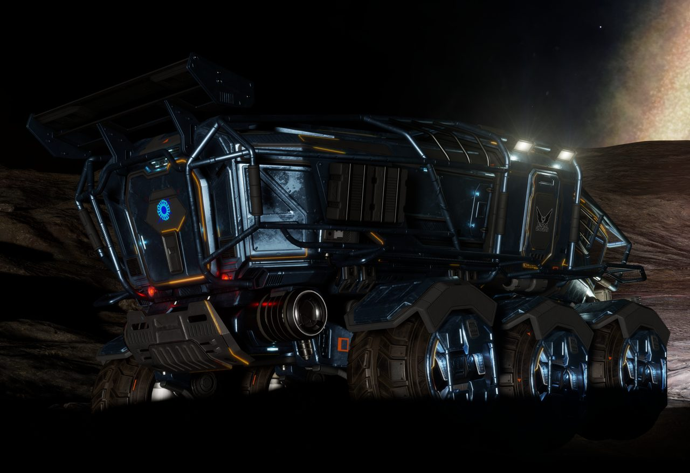
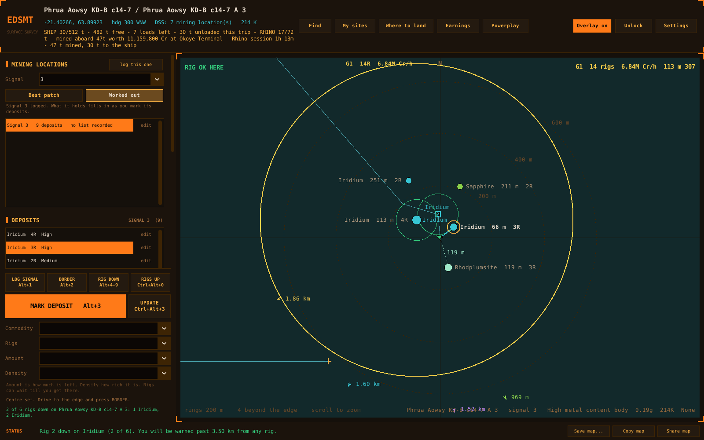
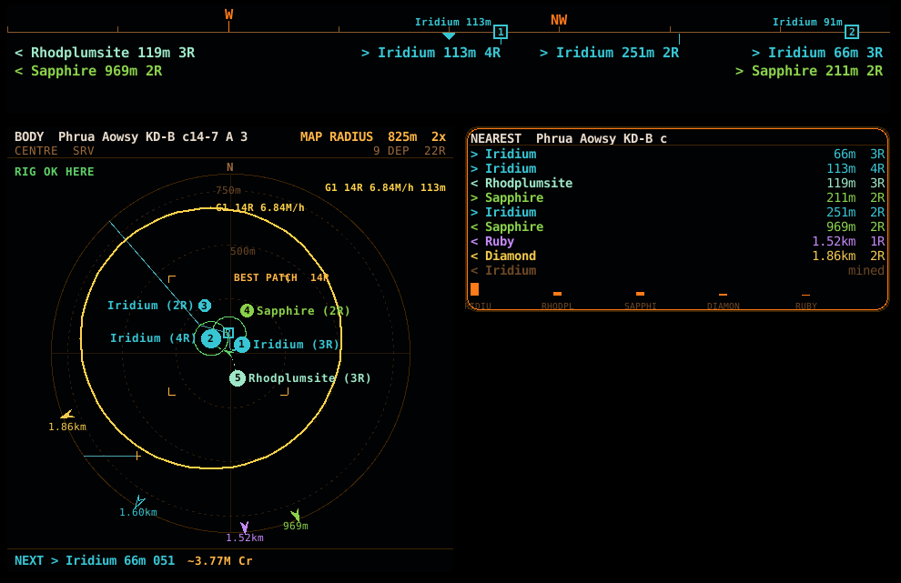
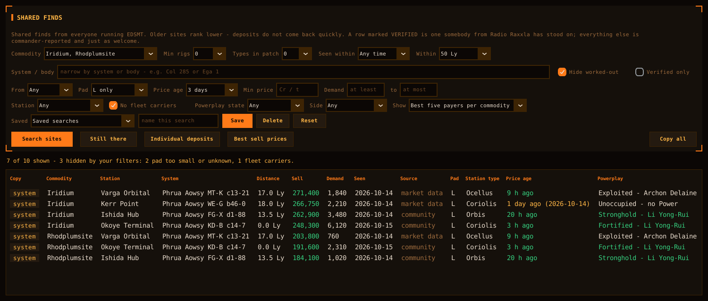
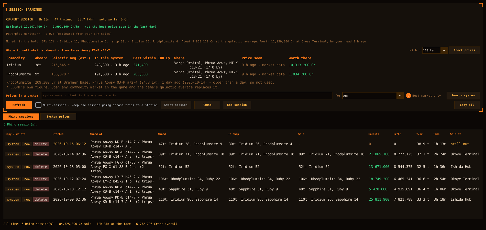

# EDSMT — Surface Mining for Elite Dangerous


<sub>The Rhino — screenshot by CMDR TheAnnouncer. Elite Dangerous © Frontier Developments plc.</sub>

A free companion for Rhino surface mining, on Windows and Linux. EDSMT reads the game's
journal as you play, so you never type a coordinate, a system name or a
distance: it maps the deposits, guides the survey, tracks your rigs, and
tells you where to sell and what the session earned.

Free and open source (GPL-3.0). Not affiliated with Frontier Developments.

| | |
|---|---|
|  |  |
| The map: your finds, your trail, the best patch and the rigs you have down | The overlay over the game, in the Rhino |
|  |  |
| Find: where to sell, with filters that hide what is no use to you | Earnings: the session you are on, then every one before it |

<sub>Screenshots from a made-up session.</sub>

## What it does

- **Survey** — log a mining location, set its border, and follow numbered
  waypoints until the ground is swept.
- **Rigs** — every rig on the map, the scope and the compass, spacing rings,
  NEXT RIG to the nearest legal spot, and warnings before one is lost.
- **Selling** — the one station that takes your whole hold, within the jumps
  you choose, with every price aged and stale ones marked.
- **Powerplay** — what selling in each system does for your Power, judged by
  where each tonne was mined.
- **Earnings** — Rhino sessions only, with Cr/hr, t/hr and merits.
- **Search** — Find, Where to land and My sites with full filters and saved
  searches.
- **Community map** — every find is shared with your commander name, so
  everyone sees what has been mapped, and a weekly and monthly leaderboard
  with Powerplay merits.
- **Controls** — keys, joystick and HOTAS buttons, or chat commands.

## Get it

**[radioraxxla.com/EDSMT](https://www.radioraxxla.com/EDSMT/)** — `EDSMT-Setup.exe`
installs for you only (no admin prompt) to `C:\EDTools\RadioRaxxla\EDSMT`;
`EDSMT.exe` is the same program as one portable file. Updates download in the
background and install when you press **INSTALL UPDATE**.

Windows 10 or 11, 64-bit. Elite Dangerous in borderless or windowed mode for
the overlay. The build is not code-signed yet, so SmartScreen warns on first
run: **More info → Run anyway**. See [SECURITY.md](SECURITY.md).

## Run from source

Windows 10 or 11 and Python 3.10 or newer; the downloads are built with
3.12.

```bat
git clone https://github.com/TheAnnouncer/EDSMT.git
cd EDSMT
python -m venv .venv
.venv\Scripts\activate
pip install -r requirements.txt
python edsmt.py
```

Or double-click `RUN.bat` in the folder. It makes the `.venv`, installs what
`requirements.txt` lists and starts EDSMT, and offers to install Python
through winget if there is none.

`BUILD.bat` makes `EDSMT-Setup.exe` and `EDSMT.exe` the way the downloads
are made, fetching Inno Setup for the installer if it is missing. The same
build runs on GitHub from `.github/workflows/build.yml`.

## Linux

The same program, for Elite played through Proton, Lutris, Heroic or
Bottles. Each release carries `EDSMT-linux-x86_64.tar.gz` on the
[Releases](https://github.com/TheAnnouncer/EDSMT/releases) page: unpack it
and run `./EDSMT`. Or run from source with `bash RUN.sh`, which needs
Python 3.10 or newer with tkinter. The game's Saved Games folder is found
inside whichever Wine prefix is being played in. Hotkeys need an X11
session; the overlay cannot be clicked through on Linux. The
[user guide](docs/GUIDE.md#linux) has the detail.

---

## Documentation

- [User guide](docs/GUIDE.md) — every key, window and setting
- [Changelog](CHANGELOG.md) — what changed in each version
- [Security and privacy](SECURITY.md) — what is checked, and what leaves your PC
- [Contributing](CONTRIBUTING.md) — bug reports and pull requests

## Support

Open an issue on this repository, or ask in the Radio Raxxla Discord. Quote
the version from the title bar.

## Licence

Copyright (C) 2026 Radio Raxxla. Released under the GNU General Public
License version 3 only (GPL-3.0-only). See [LICENSE](LICENSE).
